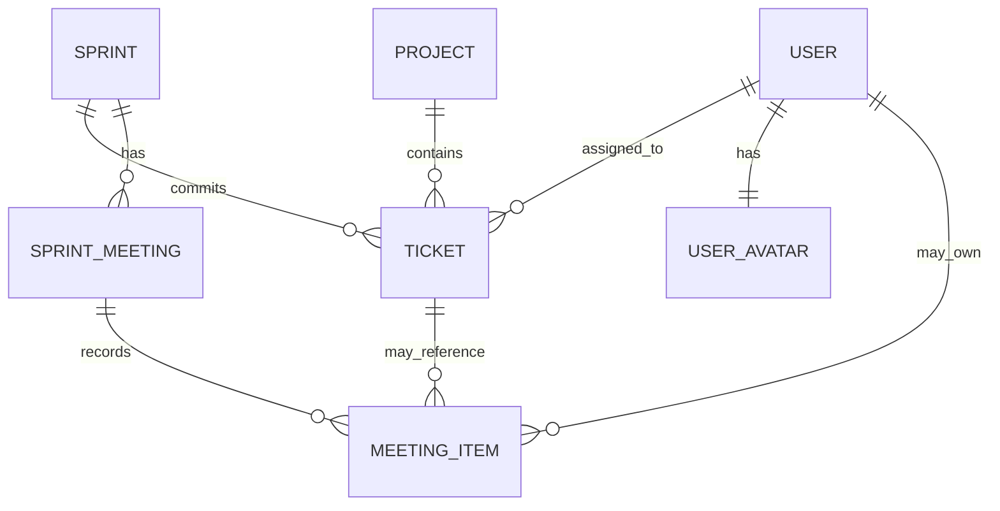

# ClovirAssist UI/UX 재설계 및 업무 흐름 개선 지시서

## 0. 작업 시작 전에 반드시 할 것

먼저 저장소의 아래 정본과 현재 Git 상태를 확인한다.

- `CLAUDE.md`
- 현재 `docs/platform/WORK_STATE.md`
- 현재 `docs/ui-renewal/WORK_STATE.md`가 존재하면 확인
- 필요한 경우에만 `MASTER_PLAN.md`, `BACKLOG.md`, `DECISIONS.md`
- Ticket, Project, Sprint, Document, Chat, RBAC 관련 실제 Source와 DB Schema

이 문서와 함께 제공된 이미지 참고자료도 반드시 확인한다.

### 디자인 시안

작업 보드 / 스프린트:
- `./references/mockups/01_work_board_concept.png`
- `./references/mockups/02_sprint_meeting_concept.png`
- `./references/mockups/03_combined_board_sprint_concept.png`

문서 / 지식:
- `./references/mockups/documents/01_document_workspace.png`
- `./references/mockups/documents/02_new_document_modal.png`
- `./references/mockups/documents/03_document_editor_detail.png`
- `./references/mockups/documents/04_document_trash.png`

### 현재 문서 도메인 조사 참고

- `./references/domain/knowledge-domain-map.html`
- `./references/domain/DOCUMENT_DOMAIN_CURRENT_STATE.md`

이 두 파일은 2026-08-27 현재 Source 조사 결과를 이해하기 위한 참고자료다.
저장소의 실제 최신 Source가 항상 최종 기준이다.

### 현재 제품 스크린샷

- `./references/screenshots/current_product/`

스크린샷 파일별 의미는 `./references/REFERENCE_INDEX.md`를 참고한다.

중요:

- 시안은 기능 배치, 정보 계층, 밀도, 시각화 방향을 참고하기 위한 것이다.
- 시안을 픽셀 단위로 복제하지 마라.
- 현재 ClovirAssist의 공통 Shell, Sidebar, Header, Typography, Spacing, Theme, 공통 Component 계약은 유지하고 그 위에서 개선한다.
- 현재 Source와 실제 Domain Contract가 시안보다 우선한다.
- 화면별 임시 CSS 값으로 맞추지 말고 공통 원인이 있으면 공통 Component에서 해결한다.

---

# 1. 이번 작업의 핵심 목표

현재 제품은 기능은 많지만 화면마다 Layout, Filter, Table, Status, Detail 폭, Callout, Navigation State가 서로 다르고, 작업 보드와 스프린트 회의는 실제 업무 흐름이 명확하지 않다.

이번 작업의 목표는 다음과 같다.

1. 공통 UI 계약을 정리한다.
2. Ticket 작성과 수정 흐름을 실제 사용 가능한 수준으로 개선한다.
3. Project 목록과 상세에 진행률, Health, Ticket 발생 추이를 시각화한다.
4. Backlog, Sprint, 작업 보드, 스프린트 회의의 관계를 명확히 정의하고 실제 업무 흐름으로 구현한다.
5. Chat을 일반적인 업무 Messenger 수준으로 재설계한다.
6. User Avatar를 제품 전체의 사용자 식별 요소로 도입한다.
7. 목록에서 상세로 이동한 뒤 돌아왔을 때 기존 화면 상태를 복원한다.
8. Document DB 데이터는 지금 초기화하고 Document UX를 재설계한다. Notion 재이관은 향후 별도 1회성 Migration으로 수행한다.

---

# 2. Backlog, Sprint, Ticket Status, Board의 최종 관계

이 부분은 구현 전에 반드시 이해하고 Domain Contract에 반영한다.

## 2.1 Backlog는 Ticket Status가 아니다

`백로그`를 Ticket 상태값에 추가하지 않는다.

백로그의 의미는 다음과 같다.

> 아직 특정 Sprint에 실행 대상으로 확정되지 않은 Ticket 후보 목록

Ticket의 업무 상태와 계획 위치를 분리한다.

### Ticket 업무 상태

최종 Workflow Status 의미는 아래처럼 정리한다.

- 계획
- 진행 중
- 검증
- 완료
- 보류
- 취소

`백로그`, `이슈`, `지연`, `차단`을 Workflow Status로 추가하지 않는다.

- `백로그`는 Sprint 편입 전 위치/계획 상태다.
- `이슈`는 업무 진행 단계가 아니라 별도 Issue Signal이다.
- `차단`은 진행을 막는 별도 Blocked Signal이다.
- `지연`은 마감일과 완료 여부에서 계산되는 파생 상태다.
- `보류`는 의도적으로 작업을 멈춘 Workflow Status다.
- `취소`는 더 이상 수행하지 않는 종료 Status다.

현재 DB에 이미 `이슈` Status 값이 존재하므로 이름만 일괄 `보류`로 치환하지 마라.
실제 기존 `이슈` Ticket의 사용 의미와 상태 변경 이력을 먼저 조사하고,
보류에 해당하는 데이터와 실제 Issue/Blocked 의미를 구분한 뒤 안전한 Migration을 설계한다.
애매한 기존 데이터를 임의 추측으로 변환하지 않는다.

### Backlog 여부

Backlog는 `sprint_id`가 없는 활성 Ticket으로 표현하는 것을 우선 검토한다.

즉:

- `sprint_id = null` -> Backlog
- `sprint_id != null` -> 해당 Sprint에 편입됨

별도의 `BACKLOG` Status를 만들지 않는다.

기존 Schema가 이 방식과 맞지 않으면 동일한 의미를 유지하는 최소 변경을 설계한다.

## 2.2 권장 업무 흐름

```text
새 Ticket 생성
    ↓
Backlog
    ↓  스프린트에 추가
선택 Sprint + 상태 '계획'
    ↓
진행 중
    ↓
검증
    ↓
완료
```

예외 흐름으로 `보류`, `취소`가 존재한다.
`이슈 있음`, `차단됨`, `지연`은 위 Workflow와 별도로 표시한다.

예:
- 진행 중 + 이슈 있음
- 진행 중 + 차단됨
- 검증 + 지연
- 보류

## 2.3 Backlog에서 Sprint로 옮기는 방법

사용자가 Backlog Ticket의 상태를 수동으로 `계획`으로 바꾸는 것만으로 Sprint에 들어가게 만들지 않는다.

명확한 Action을 사용한다.

- `스프린트에 추가`
- Sprint 선택
- 편입 후 Board의 `계획` Column에 표시

Backlog 화면과 Sprint Meeting의 후보 목록 양쪽에서 이 Action을 제공할 수 있다.

## 2.4 작업 보드에 표시되는 Ticket

기본적으로 선택한 Sprint에 편입된 Ticket만 Kanban Board에 표시한다.

상단에는 반드시 다음 Context가 있어야 한다.

- Project Filter
- Sprint Selector
- Assignee Filter
- 내 Ticket만
- 차단된 Ticket만 또는 필요한 Quick Filter

여러 Project가 선택된 경우 Card에 Project 정보를 보여준다.
단일 Project가 선택된 경우 중복 정보는 줄여도 된다.

## 2.5 생성 위치에 따른 기본 동작

일반 `새 티켓` 화면에서 만드는 Ticket은 기본적으로 Backlog에 들어간다.

단, 사용자가 이미 선택된 Sprint Context 안에서 Ticket을 생성한 경우는 불필요하게 다시 Backlog로 보내지 않는다.

예:

- 일반 `새 티켓` -> Project 선택 -> Backlog
- Project Detail에서 새 Ticket -> 해당 Project + Backlog
- Work Board에서 선택된 Sprint 안의 `Ticket 추가` -> 해당 Project/Sprint를 기본값으로 넣고 `계획` Column에 생성
- Sprint Meeting의 후보 편입은 기존 Backlog Ticket의 `sprint_id`를 설정하고 `계획`으로 보이게 함

사용자가 Context를 잃지 않게 하되, Backend Contract에서 Project/Sprint 접근 권한을 다시 검증한다.

## 2.6 Backlog 탭은 유지한다

작업 보드의 `보드 / 백로그` 구조는 유지하되 역할을 명확히 한다.

### 보드

현재 Sprint에 실제로 실행 중인 업무를 관리한다.

### 백로그

아직 Sprint에 편입되지 않은 Ticket을 관리한다.

백로그에서 해야 할 일:

- Project Filter
- 검색
- 담당자
- 우선순위
- 난이도
- 예상 WD
- 마감일
- 정렬/Rank
- 빠른 수정
- `스프린트에 추가`

현재처럼 좁은 Card 한 줄 목록으로 끝내지 않는다.

---

# 2.6 Domain 연결 관계

구현 전에 현재 Schema와 비교하고 아래 의미 관계를 유지한다.



핵심 의미:

- Project는 Ticket의 업무 소속이다.
- Sprint는 Ticket의 실행 약속/기간 소속이다.
- Sprint가 없는 활성 Ticket은 Backlog다.
- Ticket Status는 `계획 / 진행 중 / 검증 / 완료 / 보류 / 취소`의 업무 진행 상태이며 Backlog 여부와 분리한다.
- Issue/Blocked/Overdue는 Status와 별도 Signal로 다룬다.
- Board는 선택 Sprint의 Ticket을 Workflow Status Column으로 보여준다.
- Sprint Meeting은 선택 Sprint의 상태를 판단하고 Backlog 후보를 편입하며 결정/Action을 기록한다.
- Avatar는 User identity의 공통 표현이며 Chat/Board/Ticket/Document에서 동일한 Source를 사용한다.

### 시각화에 필요한 실제 데이터

새 디자인을 그리기 위해 가짜 값을 만들지 않는다. 현재 DB에서 확보하거나 필요한 최소 Domain Data를 추가한다.

- Ticket 생성 추이 -> `created_at`
- Sprint Burndown -> Sprint 기간, 예상 WD, 완료/상태 변경 이력
- 담당자 Workload -> assignee + estimated WD + 완료 여부
- Scope 변경 -> Sprint 편입/제외 이력 또는 동일 의미의 Audit Event
- 지연/마감 임박 -> due_date + 완료 상태
- Board 순서 -> board rank/order
- Backlog 순서 -> backlog rank/order
- Velocity -> 과거 Sprint의 완료 WD 또는 실제 완료량

Sprint Health 같은 합성 점수를 사용한다면 점수를 장식으로 만들지 않는다. 실제 지표를 기반으로 계산식을 명시하고 구성 요소를 UI에서 확인할 수 있게 한다. 계산식과 의미는 정본에 고정한다.

---

# 3. Sprint Domain을 실제로 사용할 수 있게 정리

현재 Sprint가 단순 날짜 범위처럼만 쓰이고 실제 관리 Entity가 부족하다면 Sprint Domain을 보강한다.

최소한 다음 개념이 필요하다.

## Sprint

- id
- name
- start_date
- end_date
- goal 또는 short objective
- status: planned / active / closed 정도
- scope 또는 team/department relation
- created_by
- created_at
- updated_at

현재 Product의 조직/부서 Scope 계약을 그대로 사용한다.

Sprint 하나에 여러 Project의 Ticket이 포함될 수 있게 설계하는 것을 우선한다.
그 상태에서 Work Board와 Sprint Meeting의 Project Filter가 Sprint 내부 Ticket을 좁힌다.

## Ticket 추가 필드 또는 관계

현재 Schema를 확인한 후 필요한 최소 변경만 한다.

- `sprint_id` nullable
- `backlog_order` 또는 Rank
- `board_order` 또는 Column별 Rank
- `estimated_wd` 신규 생성 시 필수
- `due_date` 신규 생성 시 필수
- `assignee_id`
- `created_at`
- 완료 시각
- 상태 변경 이력

기존 Ticket의 null 값 때문에 Migration이 실패하지 않게 기존 데이터 호환과 신규 생성 Contract를 구분한다.

---

# 4. Sprint Meeting의 역할

Sprint Meeting은 단순 Dashboard가 아니다.

목적은 다음 질문에 답하는 것이다.

1. 이번 Sprint가 정상적으로 진행되고 있는가?
2. 어떤 Ticket이 지연/차단/미할당 상태인가?
3. 담당자별 Workload가 과하거나 비어 있지 않은가?
4. Scope가 중간에 얼마나 바뀌었는가?
5. Backlog에서 이번 Sprint에 추가할 Ticket은 무엇인가?
6. 회의에서 무엇을 결정했고 다음 Action은 무엇인가?

시안 `./references/mockups/02_sprint_meeting_concept.png`의 정보 계층을 참고하되 그대로 복제하지 않는다.

## 상단 Context

- Project Filter
- Sprint Selector
- Team/Scope
- 이전 Sprint / 다음 Sprint
- 회의 일시
- 필요하면 회의 메모 저장

## 핵심 Summary

- 전체 Ticket
- 완료
- 진행 중
- 지연
- 이슈
- 차단
- 남은 WD

## Visualization

Burndown 하나만 보여주지 않는다.

실제 데이터로 의미 있는 3~4개 정도를 선택한다.

권장:

- Burndown, Remaining WD
- Ticket 생성 추이 또는 Scope 변화
- 담당자별 남은 WD
- Sprint Health Gauge
- Status Distribution은 필요할 때 보조 사용

그래프 수를 늘리는 것이 목적이 아니다.
회의에서 판단 가능한 정보만 사용한다.

## 오늘 논의할 항목

단순 `계획 논의` Table을 없애고 다음 유형으로 재구성한다.

- 지연 Ticket
- 차단 Ticket
- 미할당 Ticket
- 마감 임박
- Scope 변경

각 항목에서 관련 Ticket으로 바로 이동할 수 있어야 한다.

## 이번 Sprint 후보

Backlog에서 이번 Sprint에 편입할 후보를 보여준다.

- Ticket ID
- 제목
- Project
- 우선순위
- 예상 WD
- 담당자
- 마감
- `추가`

후보는 실제 Backlog Ticket을 기준으로 한다.

## 회의 결정 및 다음 Action

회의 결과가 화면을 닫으면 사라지지 않게 저장한다.

최소한 다음 구조를 검토한다.

- Decision
- Action Item
- Ticket Link nullable
- Assignee nullable
- Due Date nullable
- 완료 여부

기존 Domain에 유사한 구조가 있으면 재사용한다.

---

# 5. 작업 보드 전면 재설계

시안 `./references/mockups/01_work_board_concept.png`를 참고한다.

현재 Board의 6개 Column을 화면에 억지로 압축하거나, 백로그를 한쪽에 세로로 늘어놓는 방식에서 벗어난다.

## 상단

- Project Filter 필수
- Sprint Selector 필수
- Assignee Filter
- 내 Ticket만
- 차단된 Ticket만
- 필요하면 Board/List/Calendar View
- Ticket 추가

## Summary

- 전체
- 계획
- 진행 중
- 검증
- 완료
- 보류
- 이슈 있음
- 차단됨
- 지연

여기서 `계획 / 진행 중 / 검증 / 완료 / 보류 / 취소`만 Workflow Status이고,
`이슈 / 차단 / 지연`은 별도 Signal이다.
같은 의미는 제품 전체에서 같은 Pill/Icon/Semantic Color를 사용한다.

## Kanban

기본 실행 Column은 다음을 우선한다.

- 계획
- 진행 중
- 검증
- 완료

`보류`는 별도 접힌 Column 또는 Quick View로 관리할 수 있다.
`취소`는 기본 실행 Board에서 숨기고 Filter/Archive View로 확인하는 방식을 우선한다.

`이슈`, `차단`, `지연` 때문에 Ticket을 다른 Workflow Column으로 강제로 옮기지 않는다.
현재 Column 안의 Card에 Signal을 표시하고 Quick Filter로 모아볼 수 있게 한다.

각 Card에는 필요한 정보만 표시한다.

- Ticket ID
- 제목
- Project 필요 시
- Priority
- Due Date
- Assignee Avatar

Card가 너무 많은 정보를 담지 않게 한다.

Column별 내부 Scroll을 사용하고 Board 전체가 Ticket 수만큼 아래로 끝없이 늘어나지 않게 한다.
Column이 화면 폭보다 많으면 Kanban 영역 내부 Horizontal Scroll을 허용한다.

Drag and Drop으로 상태와 순서를 변경한다.
Backend 상태 전이 Contract가 허용하지 않는 이동은 막는다.

## Board 하단 또는 보조 영역

실제 필요가 있을 때 다음 중 일부를 배치한다.

- 오늘 처리할 일
- 최근 변경
- 차단 Ticket
- 날짜별 마감 분포

시안의 요소를 전부 넣지 말고 현재 데이터와 사용성을 기준으로 선택한다.

---

# 6. 사용자 Avatar 시스템 추가

사용자 식별을 텍스트 이름만으로 하지 않는다.

Avatar는 다음 화면에서 공통 사용한다.

- 오른쪽 상단 사용자 영역
- Chat
- Ticket 담당자
- Ticket 댓글
- Work Board Card
- Sprint Meeting 담당자
- Document 작성자
- Activity 등 사람을 표시하는 공통 영역

## 기본 Avatar

새 사용자에게 귀여운 기본 Avatar를 제공한다.

- 동물, 사람, 로봇 등 친근한 스타일의 내부 제공 세트
- 모두 같은 이미지 사용 금지
- 사용자 UUID 등을 Seed로 사용해 안정적으로 기본 Avatar를 배정
- 재로그인/재부팅마다 랜덤으로 바뀌면 안 됨
- 외부 URL Runtime 의존 금지
- 제품 Asset 또는 내부 Storage에 포함

필요하면 사용자가 기본 Avatar 세트 중 다른 것을 선택할 수 있다.

## 직접 사진 업로드

`내 프로필 > 사진 바꾸기`에서 변경한다.

업로드 후 자동 Center Crop으로 끝내지 않는다.

Crop UI를 제공한다.

- 원본 이미지 표시
- 원형 Crop Mask
- 마우스 Drag로 위치 이동
- 확대/축소
- 원형 Preview
- 저장
- 취소

모바일에서도 기본적인 이동/확대가 가능해야 한다.

## 데이터 저장

현재 User/Profile/Storage Schema를 먼저 확인한다.
직접 File Path를 새로 난립시키지 말고 기존 Storage abstraction을 우선 재사용한다.

필요한 개념:

- avatar_source: default / uploaded
- avatar_default_key
- avatar_file_id 또는 기존 Storage File relation
- crop_x
- crop_y
- crop_zoom 또는 scale
- crop_size 필요 시
- avatar_updated_at

원본과 Crop 정보를 보관하고 표시용 Thumbnail을 생성하는 방식을 우선한다.

## 이미지 안전성

- 허용 MIME 실제 검사
- jpg/png/webp 정도
- 적절한 최대 용량
- 최소 이미지 크기
- 서버에서 안전하게 Decode/Re-encode
- EXIF Orientation 처리
- 업로드 파일명을 그대로 경로로 사용하지 않음

Avatar를 표시하는 공통 Component 하나를 만들고 각 화면에서 따로 구현하지 않는다.

---

# 7. 공통 Status / Signal 표현 통일

현재 `지연`, `이슈` 등 일부만 강한 Background가 있고 나머지는 파란색/회색이라 일관성이 없다.

## Workflow Status

- 계획
- 진행 중
- 검증
- 완료
- 보류
- 취소

## 별도 Signal

- 이슈 있음
- 차단됨
- 지연

`지연`은 due_date와 완료 여부에서 계산하고,
`이슈`와 `차단`은 실제 Domain Field/현재 사용 구조를 조사해 Workflow와 분리한다.

Status와 Signal을 제품 전체에서 공통 Pill/Icon + Semantic Color 체계로 정리한다.

같은 의미는 다음 모든 화면에서 동일하게 보여야 한다.

- My Tickets
- Team Tickets
- Ticket Detail
- Home
- Board
- Sprint Meeting
- Search
- Project 관련 Ticket 목록

큰 행 전체 Background를 상태색으로 칠하지 않는다.
위험/오류 의미가 아닌 값에 강한 Red Background를 사용하지 않는다.

# 8. 공통 Filter UI

Project 화면의 Filter가 My Tickets, Team Tickets와 다른 구조로 보이지 않게 한다.

공통 `FilterSurface` 계약을 사용한다.

통일 대상:

- Search
- Select
- Toggle
- Reset
- Active Filter
- 높이
- Label
- 간격
- Responsive

---

# 9. Table Header와 Cell 정렬 계약

모든 DataTable/Grid의 Header Label은 중앙 정렬을 기본으로 한다.
Sort/Filter Icon 때문에 Label 자체의 중앙이 밀리지 않게 한다.

Cell은 **제목만 왼쪽이고 나머지는 전부 가운데**다 (2026-09-06 개정).

## 왼쪽 정렬

- 제목 (`type: "title"`) — 표당 하나뿐인, 그 행이 무엇인지 말하는 열

## 가운데 정렬

- 그 밖의 전부. 이름, 설명/긴 텍스트, Ticket ID, 상태, 우선순위, 난이도, WD, 날짜,
  건수, 퍼센트, Health 점수, 짧은 Code/Type, Action, 그리고 타입을 안 적은 열.

## 왜 바꿨나

처음 계약은 「읽는 것은 왼쪽, 보는 것은 가운데」였고 왼쪽에 이름과 설명이 들어 있었다.
그 구분이 화면에서 만든 것은 **머리글과 값이 다른 축에 서는 열**이다 — Header Label은
언제나 중앙인데 값만 왼쪽이라, `/users` 의 「이름」은 자기 머리글보다 76px 왼쪽에
서 있었다. 열마다 축이 둘이면 눈이 표를 한 덩어리로 못 읽는다.

제목만 남긴 것은 그 열이 다른 열과 성질이 다르기 때문이다. 표당 하나이고, 남는 폭을
전부 가져 값이 실제로 칸을 채운다 — 가운데에 두면 행마다 시작점이 크게 흔들린다.
나머지 열은 값이 짧아 그 흔들림이 작다(기본 폭 이름 열 실측 16px).

**아는 대가.** 앞이 같고 뒤가 갈리는 값(경로·페이로드)은 왼쪽 모서리가 비교 수단이었다.
가운데로 가면 그 수단을 잃는다. 그 열들은 값이 길어 대개 말줄임이 걸리므로 전체를 볼
길은 마우스를 올렸을 때의 전체 문구와 상세 화면으로 남는다.

공통 `ColumnTypes` 계약에서 해결한다.

Ticket Table의 `추가`가 생성 시각이면 `생성 일자`로 변경한다.

---

# 10. New Ticket 재설계

현재 `작성 도움`의 문장이 추상적이고 사용자가 무엇을 써야 하는지 이해하기 어렵다.

오른쪽 도움말은 너무 많은 항목을 넣지 말고 다음 핵심만 제공한다.

1. 배경 / 문제
   - 왜 필요한가?
   - 지금 어떤 문제가 있는가?

2. 목표 / 의도
   - 무엇을 달성하려는가?

3. 작업 범위
   - 해야 할 것
   - 이번 작업에서 하지 않을 것

4. 완료 기준
   - 어떤 상태가 되면 완료인가?

필요하면 예외/검증 방법 정도만 보조한다.
각 도움 항목에는 짧은 실제 예시를 제공한다.

## Editor Toolbar

현재 Renderer가 실제 지원하는 범위에서 다음을 제공한다.

- Heading
- Bullet List
- Numbered List
- Checklist
- Divider
- Emoji
- Link
- Quote
- Code / Code Block

Renewal 중 사라진 유용한 기능이 있으면 실제 Source와 Renderer를 확인해서 복구한다.

## 신규 생성 필수값

- Project
- 예상 WD
- 마감일

사용자의 기존 요구대로 예상 WD와 마감일은 신규 생성 시 필수다.
Frontend 표시만 하지 말고 API Create Contract에서도 누락을 거부한다.

---

# 11. Ticket 담당자 변경

일반 사용자도 자신이 접근 가능한 Project/Ticket 범위에서는 담당자를 변경할 수 있어야 한다.

- 자신
- 같은 접근 범위의 다른 적격 사용자

를 선택 가능하게 한다.

볼 수 없는 조직/Project 사용자까지 선택 가능하게 만들지 않는다.
Frontend와 Backend Permission Contract가 동일해야 한다.

---

# 12. My Tickets Inline Status 변경

상세 수정 화면에 들어가지 않고 Grid에서 Status를 변경할 수 있게 한다.

Status Pill/Cell 클릭 -> Dropdown/Popover -> 허용 상태 선택.

- 저장 중 표시
- 성공 반영
- 실패 시 원복 + 오류 안내

실제 Backend 상태 전이 규칙을 따른다.

---

# 13. 목록 상태 복원

Ticket/Document/Backlog 등에서:

목록 중간 -> 상세 -> 수정 -> 뒤로가기

했을 때 아래가 유지되어야 한다.

- Scroll 위치
- Filter
- Sort
- Pagination
- Group
- Tab
- Search
- Project/Sprint Context

공통 Navigation State 문제로 해결한다.
페이지별 임시 전역변수 금지.

---

# 14. 공통 Detail Layout

Ticket Detail, 게시판, 기능개선 제안, Document Detail 등에서 본문이 왼쪽에 몰리고 오른쪽이 비는 문제를 공통 Layout에서 해결한다.

조사 대상:

- PageShell
- DetailLayout
- ContentContainer

Aside가 있는 화면은 Main/Aside 비율을 명확히 한다.
Aside가 없으면 Main이 충분히 Content 영역을 사용한다.
큰 화면에서 읽기 어려울 정도로 무제한 확장하지는 않는다.

---

# 15. Project 목록 재설계

현재 숫자만 나열되는 Summary를 개선한다.

- 평균 진행률 -> Progress Bar + %
- Health -> Gauge/Donut + 점수
- 위험 Project/Health 하위 -> 시각적 Indicator
- 지연 Milestone -> Compact Visualization

가능하면 Summary 선택 시 아래 Project 목록이 해당 조건으로 필터링되게 한다.

---

# 16. Project Detail 재설계

Project Detail의 정보 순서를 다음처럼 검토한다.

```text
개요
Ticket 발생 추이
진행률
Health
기타 Project 정보
```

## Ticket 발생 추이

Ticket `created_at` 기준으로 날짜별 생성량을 보여준다.

- X축: 날짜
- Y축: 생성 Ticket 수
- Bar/Histogram
- 긴 기간은 Chart 내부에서 좌우 탐색
- 전체 Page에 Horizontal Scroll을 만들지 않음

사용자가 어느 시점에 업무가 집중적으로 발생했는지 볼 수 있어야 한다.

진행률은 숫자만 표시하지 말고 Progress Bar를 함께 사용한다.
Health는 점수와 함께 원형 Visualization을 사용한다.

---

# 17. Chat 전면 재설계

현재 Chat UI는 일반 업무 Messenger로 사용하기 어렵다.

구조:

- Room List
- Room Header
- 참여자
- Message Area
- Composer

Message는 다음 정보 관계가 명확해야 한다.

- Avatar
- 이름
- 날짜/시간
- 메시지

자신이 쓴 메시지도 Avatar를 표시한다.
시간만 보여주지 않는다.
날짜가 바뀌면 Day Separator를 보여준다.

같은 사용자의 연속 메시지는 과도한 반복을 줄일 수 있지만 누가 언제 썼는지는 항상 확인 가능해야 한다.

현재 Chat DB 데이터는 사용자가 삭제를 허용했다.
삭제 전 Snapshot, Table 관계, Row Count 확인 후 Chat Domain 데이터만 일관성 있게 초기화한다.
User/Organization/Project/Ticket 데이터는 삭제하지 않는다.

---

# 18. Profile UX

`둘러보기`는 화면 강조색 등 개인 UI 설정보다 위에 배치한다.

Avatar 기능도 `내 프로필`에 배치한다.

- 현재 Avatar
- 사진 바꾸기
- 기본 Avatar 선택 가능 시 선택
- 업로드 Crop Dialog

---

# 19. 사용자 역할 UI 정리

사용자 수정에서 역할 차이가 이해되게 한다.

현재 RBAC Source를 읽고 실제 차이를 설명한다.

- 일반 사용자
- 운영자
- 관리자
- 감사자
- 시스템 관리자

역할 설명은 실제 Permission과 일치해야 한다.
추측으로 새 의미를 만들지 않는다.

현재 `변경 요구` Checkbox가 무엇인지 Backend Field까지 추적한다.
실제 의미가 `다음 로그인 시 비밀번호 변경`이라면 그렇게 이름을 바꾼다.
Runtime 효과가 없다면 제거한다.

---

# 20. 공통 Callout 재설계

조직 정합성 등의 현재 `안내`, `주의` 디자인을 공통 Component로 다시 만든다.

종류:

- 안내
- 주의
- 성공
- 오류

구조:

- Icon
- 제목
- 본문
- 필요한 Action

현재처럼 제목과 본문 사이가 이상하게 벌어지거나 특정 AI 제품 스타일을 흉내낸 장식을 사용하지 않는다.
ClovirAssist Design System으로 통일한다.

---

# 21. 관리자 공통 Page Layout

관리자 화면의 기본 순서를 통일한다.

```text
Breadcrumb
Title + Primary Action
짧은 설명
필요한 Callout
Filter/Toolbar
Main Content
```

화면별로 안내가 오른쪽 끝에 떠 있거나 Content 시작점이 달라지지 않게 한다.

---

# 22. Document DB 초기화와 Document / Knowledge UX 전면 재설계

이 부분의 사용자 의도는 다음과 같이 확정한다.

> 현재 Document DB의 사용자 문서 데이터는 지금 비운다.
> Notion에서 다시 가져오는 작업은 이번에 하지 않는다.
> 향후 별도 1회성 Migration/Import 작업으로 다시 가져온다.

Notion Runtime Sync를 다시 제품에 넣지 않는다.

디자인 참고:
- `./references/mockups/documents/01_document_workspace.png`
- `./references/mockups/documents/02_new_document_modal.png`
- `./references/mockups/documents/03_document_editor_detail.png`
- `./references/mockups/documents/04_document_trash.png`

현재 구현 조사 참고:
- `./references/domain/knowledge-domain-map.html`
- `./references/domain/DOCUMENT_DOMAIN_CURRENT_STATE.md`
- 현재 제품: `./references/screenshots/current_product/20_documents_page.png`
- 현재 휴지통: `./references/screenshots/current_product/21_document_trash_current.png`

시안은 매우 적극적으로 참고하되 그대로 복제하지 않는다.
특히 Global Header / Sidebar / Breadcrumb / Page Title / Top Action 같은 ClovirAssist 공통 PageShell은 유지한다.
문서 기능만 별도의 독립 제품처럼 보이게 만들지 않는다.

## 22.1 현재 실제 Document Domain을 기준으로 설계

현재 정본은 `app/knowledge`, 화면은 `/knowledge`, API는 `/api/knowledge/*`다.

핵심 구조는 다음과 같다.

```text
Knowledge Space
 ├─ Folder Tree
 └─ Document
      ├─ Document Version (본문 정본)
      ├─ Tags
      ├─ Relations / Backlinks
      ├─ Attachments
      ├─ Mentions(User / Document / Ticket)
      ├─ Comments
      ├─ Favorites
      └─ Recent Views
```

중요한 현재 계약:

- 모든 문서는 반드시 하나의 `knowledge_space`에 속한다.
- Folder는 정리 위치이며 문서 권한을 바꾸지 않는다.
- 문서 가시성은 Space의 Ownership/Visibility를 상속한다.
- 문서 본문 정본은 `document_versions.body` JSONB의 TipTap/ProseMirror Block Tree다.
- `body_markdown`, `body_text`는 파생값이다.
- Project 연결은 Document 직접 FK가 아니라 Space Ownership을 통해 이루어진다.
- Ticket은 본문 Mention으로 연결할 수 있다.
- Document Relation으로 문서끼리 참조/관련/대체 관계를 만들 수 있다.
- 첨부 파일 Backend와 AI Index 연결은 이미 존재한다.
- 목록/상세/Search/AI의 Permission은 같은 Visibility Contract를 따라야 한다.

이 계약을 UI 편의를 위해 깨지 마라.

## 22.2 현재 Legacy와 Native Knowledge를 섞지 않는다

현재 옛 `app/team_docs` / `document_cache`는 Legacy Mirror이고
현재 `/knowledge` 화면은 그것을 읽지 않는다.

새 Document UI와 Trash를 만들면서
옛 `/api/team-docs/*`를 다시 Runtime Source로 사용하지 마라.

Legacy 정보는 향후 1회성 Migration/History에 필요한 범위만 유지한다.
정리 여부는 실제 참조와 기존 Backlog를 확인한 뒤 결정한다.

## 22.3 지금 할 데이터 초기화

실행 전 반드시:

- Backup/Snapshot
- 실제 Knowledge 관련 Table
- FK/CASCADE/SET NULL 관계
- 삭제 Row Count
- Search/AI 파생 데이터 관계

를 확인한다.

이번에 비우는 대상은 현재 사용자 Document 데이터와 그 문서에서 직접 파생된 DB 데이터다.

예:
- documents
- document_versions
- document_tags
- document_relations
- document_attachments의 연결
- document_mentions
- document_comments
- document_favorites
- document_recent_views
- 해당 문서 Search/AI Index/Chunk/Index State

단, 실제 Schema와 FK를 확인한 뒤 처리한다.

다음은 임의 삭제하지 않는다.

- User / Organization / Project / Ticket
- Knowledge Space/Folder 자체가 향후 빈 Workspace 골격으로 필요한 경우
- Storage의 실제 Binary File
- 다른 Domain에서 참조하는 File Metadata
- Legacy Migration 계보 중 향후 1회성 Import에 필요한 정보

Binary Orphan 정리는 기존 Storage 정책과 별도 Sweep을 따른다.

## 22.4 Document Main Workspace

현재 `왼쪽 좁은 Space Panel + 오른쪽 긴 Card 목록`을 그대로 다듬는 수준으로 끝내지 않는다.

`01_document_workspace.png`의 방향처럼 문서를 실제 Knowledge Workspace로 재설계한다.

### Page Top

공통 PageShell을 유지한다.

- Breadcrumb
- `문서` Title
- 짧은 설명
- 우측 `휴지통`
- 우측 Primary `새 문서`

`새 문서`와 `휴지통`을 별도의 Floating UI로 만들지 않는다.

### Summary

필요한 실제 데이터가 있을 때만 Compact Summary를 둔다.

예:
- 전체 문서
- 최근 수정
- 즐겨찾기
- 내 초안

Summary는 장식용 숫자 나열이 아니라 클릭 시 해당 View/Filter로 좁힐 수 있게 한다.

### Left Navigation / Explorer

Space와 Folder를 한눈에 탐색할 수 있게 한다.

- 전체 문서
- 팀/조직 Space
- Project Space
- 내 초안
- 즐겨찾기
- 최근 열람
- Folder Tree
- Tag Shortcut 필요 시

Folder가 없다고 큰 빈 Panel이 남지 않게 한다.
Tree가 길어지면 Explorer 내부에서만 Scroll한다.

Space/Folder 생성/수정 API가 실제로 존재하는 만큼
사용자가 필요한 범위에서 UI를 배선한다.
권한이 없는 Action은 보이지 않거나 비활성 이유를 명확히 한다.

### Main Document List

문서 탐색에 적합한 밀도의 List/Table 중심으로 설계한다.

필수 정보 후보:

- 즐겨찾기
- 문서 제목
- 짧은 설명 또는 본문 Preview
- Space / Folder
- Tags
- 작성자 Avatar + 이름
- 최종 수정 시각
- Version/상태가 실제 Domain에 있으면 필요한 값
- Relation/Attachment/Comment Count가 유용하면 Compact 표시
- More Action

검색/필터:
- 제목/본문 검색
- Space
- Folder
- Tag
- 작성자
- 즐겨찾기
- 최근 수정 기준 정렬

Header/Cell 정렬은 공통 DataTable 계약을 따른다.

### Right Rail

`최근 활동 / 즐겨찾기 / 문서 템플릿` 같은 보조 정보는
Desktop에 충분한 폭이 있을 때만 Right Rail로 둘 수 있다.

Main List 폭을 희생하거나 좁은 화면에서 3열을 억지로 유지하지 않는다.
1366 등에서는 접거나 Drawer/Section으로 내려도 된다.

## 22.5 `새 문서` 생성 Flow

상단 `새 문서`를 누르면
`02_new_document_modal.png`의 정보 계층을 참고한 Creation Dialog를 제공한다.

최소 입력:

- 문서 제목: 필수
- Space: 필수
- Folder: 선택
- Tags: 선택
- Template: 선택

Permission/Visibility는 실제 Domain Contract를 기준으로 한다.

현재 Domain은 Space가 기본 Visibility를 정하고 Document에는 `confidential` 축이 있으므로,
시안에 보이는 `공개 범위`를 그대로 새로운 임의 권한 모델로 만들지 않는다.
현재 Space Visibility + Confidential/Grant 계약에 맞춰 사용자에게 이해 가능한 표현으로 노출한다.

### Template

Template 기능이 현재 Domain에 없다면 먼저 실제 필요를 확인하고 최소 방식으로 구현한다.

권장 초기 Template:
- 빈 문서
- 회의록
- 요구사항 정의서
- 운영 가이드

Template는 문서 생성 시 초기 ProseMirror Body를 채워주는 Preset으로 시작해도 된다.
복잡한 Template 관리 시스템을 새로 만드는 것은 별도 필요가 있을 때만 한다.

`만들기` 성공 후 바로 `/knowledge/{id}` 편집 화면으로 이동한다.

## 22.6 Document Detail / Editor

`03_document_editor_detail.png`의 방향을 참고한다.

Main Editor가 실제 Content 영역을 충분히 사용하게 한다.
현재처럼 본문이 왼쪽에 몰리고 오른쪽이 비는 공통 Detail Width 문제를 반복하지 않는다.

### 상단

- Breadcrumb
- Title
- Favorite
- Space/Project/Folder Context
- 현재 Version
- 마지막 수정
- 공유/권한이 실제 계약에 맞으면 Action
- 이동
- Version
- 첨부
- 저장
- More

### Editor Toolbar

현재 ProseMirror Renderer가 지원하는 범위에서 최소한:

- Heading
- Font/Paragraph style 필요 시
- Bold / Italic / Underline / Strike
- Bullet List
- Number List
- Checklist
- Divider
- Emoji
- Link
- Quote
- Code / Code Block
- Table
- Image/Attachment 삽입
- Undo / Redo

를 제공한다.

기능 숫자를 늘리기 위해 Renderer가 지원하지 않는 장식 버튼을 넣지 않는다.

### Right Context Panel

필요한 정보를 작은 Card/Section으로 정리한다.

- 문서 정보
- Tags
- 관련 문서 / Backlinks
- 첨부
- 댓글 / 활동

Right Panel은 본문 편집 폭을 과도하게 좁히지 않는다.
좁은 화면에서는 Drawer/Tab/아래 Section으로 전환한다.

### 실제 미배선 Backend 기능을 연결

현재 Server에는 있지만 UI가 없는 기능을 Source 계약에 맞게 연결한다.

- Document Move
- Archive
- Version Detail
- Relation 생성/삭제
- Attachment 업로드/목록/다운로드/삭제
- Space 생성/수정이 사용자에게 필요한 범위

Backend가 이미 제공하는 기능을 UI에서 별도 가짜 상태로 흉내내지 않는다.

## 22.7 Native Knowledge Trash

현재 공통 `/team-docs/trash` 화면은 Legacy Mirror 기준이라
Native Knowledge의 `documents.archived`와 연결되지 않는다.

이 상태를 그대로 두지 않는다.

새로운 별도 Trash 제품을 만드는 것이 아니라
현재 ClovirAssist의 공통 `휴지통` Page Layout과 7일 보관 정책을 유지하면서
Native Knowledge Document를 연결한다.

Document Main의 `휴지통` 버튼은
공통 Trash 화면으로 이동하되 문서 Filter가 선택된 상태로 열 수 있다.

필요한 기능:

- Ticket + Native Document 공통 목록 또는 Kind Filter
- 문서 제목
- Space / Folder
- 삭제한 사람
- 삭제일
- 삭제 예정
- 복원
- 권한이 허용된 영구 삭제
- Bulk Action 필요 시

현재 Native Document에는 `archived=true`를 다시 `false`로 되돌리는 API가 없으므로
정상적인 Restore API/Service Contract를 구현한다.

복원 시:
- 원래 Space/Folder가 유효한지
- 권한이 유효한지
- Search/AI Index를 다시 걸어야 하는지
- Version/Relation/Attachment가 유지되는지

를 확인한다.

영구 삭제는 기존 7일 Trash 정책과 현재 Product의 삭제 계약을 재사용한다.
Legacy `trash_items`/Notion page id 구조를 Native Knowledge 복원의 정본으로 사용하지 않는다.

## 22.8 Document Relation과 Ticket 연결 UX

현재 Ticket은 Document Mention으로만 연결되고
Document Relation은 Backend가 이미 존재한다.

Editor에서 문서를 작성하며:
- `@사용자`
- Ticket Mention
- 다른 Document Link

를 자연스럽게 사용할 수 있게 한다.

상세 Right Panel에서:
- 관련 문서
- 이 문서를 참조하는 문서
- 관련 Ticket Mention

을 확인할 수 있게 한다.

새로운 직접 `document.project_id`나 `document.ticket_id`를 편의를 위해 무작정 추가하지 않는다.
기존 Space Ownership과 Mention/Relation 모델을 우선 사용한다.

## 22.9 Search / AI

목록 검색과 AI 검색의 권한 계약을 바꾸지 않는다.

- Unauthorized Document는 검색 후보/AI Context에 들어오면 안 된다.
- Archived Document는 일반 Search/AI에서 제외한다.
- Attachment Text도 부모 Document 권한을 따른다.
- 새 Editor/Attachment UI 때문에 Permission First 원칙을 우회하지 않는다.

## 22.10 공통 레이아웃 유지

문서 시안이 마음에 든다고 해서
Global Navigation과 Page 구조를 통째로 시안에 맞춰 다시 만들지 않는다.

반드시 유지할 것:

- 기존 ClovirAssist Global Sidebar
- Global Top Header/Search
- 사용자/관리자 전환
- Breadcrumb 규칙
- Page Title/Description 규칙
- 우측 Primary Action 위치
- 공통 Typography/Spacing/Theme
- 공통 Callout/DataTable/Filter/Modal 계약

새롭게 바꾸는 것은 Document Workspace 안의 정보 구조와 기능 배치다.

# 23. 데이터 삭제 안전 규칙

이번 작업에서 삭제 허용된 것은 다음뿐이다.

- 기존 Chat Domain 데이터
- 현재 Document DB 데이터와 직접 파생된 DB 데이터

실행 전 반드시:

1. 정확한 Table 확인
2. FK 확인
3. Row Count 확인
4. Snapshot/Backup 위치 기록

후 실행한다.

다음은 삭제하지 않는다.

- User
- Organization
- Project
- Ticket
- 권한/RBAC
- 요청하지 않은 다른 Domain Data

---

# 24. 공통 UI 구현 우선순위

개별 화면부터 CSS로 고치지 말고 먼저 아래 공통 계약을 확인한다.

- PageShell
- AdminPageShell
- DetailLayout
- ContentContainer
- FilterSurface
- DataTable
- ColumnTypes
- Status/Pill
- Callout
- Navigation State
- Editor Toolbar
- Avatar

공통 원인이 있으면 공통 Component에서 해결한다.

---

# 25. 구현 묶음

23개 요구를 하나씩 구현하고 매번 Full Test를 돌리지 않는다.

권장 묶음:

A. 공통 Layout / Table / Status / Filter / Callout / Navigation / Avatar
B. Ticket / New Ticket / Detail / Inline Status / Assignment
C. Project List / Project Detail Visualization
D. Sprint Domain / Backlog / Work Board / Sprint Meeting
E. Chat
F. Profile / Admin Role UX
G. Documents

각 묶음은 구현 -> 직접 관련 Targeted 검증 -> 다음 묶음 순서로 간다.

---

# 26. Browser 검증

Source만 보고 끝내지 않는다.

현재 제품 스크린샷과 시안을 나란히 보고 실제 Browser에서 확인한다.

대표 폭:

- 1366
- 1920
- 2560
- 대표 확대 배율
- Light / Dark

확인할 것:

- 왼쪽 쏠림
- 의미 없는 큰 빈 공간
- Header/Cell 정렬 불일치
- Filter 높이와 간격
- Table Horizontal Overflow
- 긴 텍스트 처리
- Status 불일치
- Chart 과장
- Detail Content 폭
- Back Navigation 상태 유실
- Modal/Dialog Layout
- Scroll 위치
- Board Column Overflow
- Sprint Graph readability
- Avatar 크기/정렬

---

# 27. QA 실행 방식

일반 구현 중에는 관련 Targeted 검증만 수행한다.

모든 구현이 끝난 마지막에만 다음을 각각 1회 수행한다.

- Frontend/Backend 전체 Regression
- 이번 변경 Surface의 Final Browser Capture

실패 하나를 고칠 때마다 Full을 다시 실행하지 않는다.
마지막 Full에서 발견된 실제 Product Defect는 한 번에 모아서 수정하고 직접 영향 범위만 재검증한다.
QA 숫자를 맞추기 위해 Product Code를 왜곡하지 않는다.

---

# 28. 배포

구현 완료 후:

1. 필요한 현재 정본 최소 갱신
2. Commit
3. Working Tree Clean 확인
4. 기존 정상 Upgrade 절차로 실제 서버 배포
5. 비파괴 Smoke

과거 S0~S22 History를 다시 작성하지 않는다.

---

# 29. 종료 보고

종료 시 다음만 정리한다.

1. 공통 UI/Layout 계약 변경
2. Avatar 구현 및 적용 화면
3. Ticket/New Ticket 변경
4. Project List/Detail 변경
5. Backlog/Sprint/Board 최종 Domain 관계
6. Work Board 재설계 결과
7. Sprint Meeting 재설계 결과
8. Chat 재설계와 데이터 초기화
9. Profile/Role/Admin UX
10. Document 초기화 및 새 Layout
11. Navigation State 복원
12. 발견한 실제 Product Defect
13. Targeted 검증 결과
14. 마지막 Full 결과
15. Commit SHA
16. 배포 Commit SHA
17. health / ready 결과

---

# 30. 원래 요청 1~23 Coverage 확인

작업 종료 전에 아래 원래 요청이 하나도 빠지지 않았는지 확인한다.

1. Workflow Status와 이슈/차단/지연 Signal 분리 및 표현 통일 -> 7
2. Project Filter UI 공통화 -> 8
3. New Ticket 작성 도움 개선 -> 10
4. Editor Emoji/기능 복구, 예상 WD/마감 필수 -> 10
5. Project Summary 진행률/Health/지연 Milestone 시각화 -> 15
6. 모든 Table Header 중앙 정렬 -> 9
7. `추가` -> `생성 일자` -> 9
8. Ticket/Document Detail 폭 -> 14
9. 일반 사용자 담당자 변경 -> 11
10. Project 진행률 Bar/Health Gauge -> 15,16
11. Project Ticket 생성 추이 -> 16
12. Work Board/Sprint Meeting 전면 재설계 -> 4,5
13. 전체 Column Cell 정렬 규칙 -> 9
14. Chat 디자인/날짜/Avatar/기존 데이터 삭제 -> 17
15. Ticket Status Color/Pill -> 7
16. 자유게시판/기능개선 상세 폭 -> 14
17. Profile 둘러보기 위치 -> 18
18. My Tickets Inline Status -> 12
19. 상세 복귀 시 목록 상태 복원 -> 13
20. 공통 안내/주의 디자인 -> 20
21. 관리자 공통 Page Layout -> 21
22. 역할 차이와 변경 요구 의미 -> 19
23. Document DB 초기화, 향후 Notion 1회성 Migration, Document 전면 재설계 -> 22

추가 요구:

- 기본 랜덤 Avatar + 사용자 사진 Crop Upload -> 6
- Backlog는 Status가 아님 -> 2
- Sprint Domain과 Board 연결 -> 2,3
- Board Project Filter 필수 -> 2,5
- Backlog -> Sprint 편입 -> 계획 Column 흐름 -> 2
- Sprint Meeting에서 Backlog 후보를 Sprint에 편입 -> 4

# 31. 이번 최종 패키지에서 추가 확정된 사항

- Workflow Status는 `계획 / 진행 중 / 검증 / 완료 / 보류 / 취소`.
- `이슈`, `차단`, `지연`, `백로그`는 Workflow Status가 아니다.
- 기존 `이슈` 데이터를 일괄 `보류`로 이름 변경하지 않는다. 기존 사용 의미를 조사한 뒤 안전하게 분리한다.
- Document UI는 제공된 4개 시안을 적극 참고한다.
- Document Main / 새 문서 / Detail Editor / Native Trash까지 하나의 연결된 UX로 구현한다.
- Document Global PageShell은 유지한다.
- Native Knowledge Trash를 기존 공통 휴지통 정책과 연결하고 Legacy `team_docs` Trash를 정본으로 사용하지 않는다.
- 현재 Document 데이터는 비우되 Notion 재이관은 이번 작업에서 하지 않는다. 향후 별도 1회성 Migration/Import로 수행한다.
- 현재 Source가 시안 또는 이 패키지의 조사 문서보다 우선한다.
